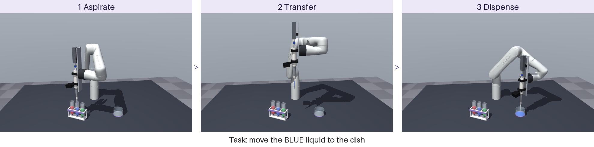
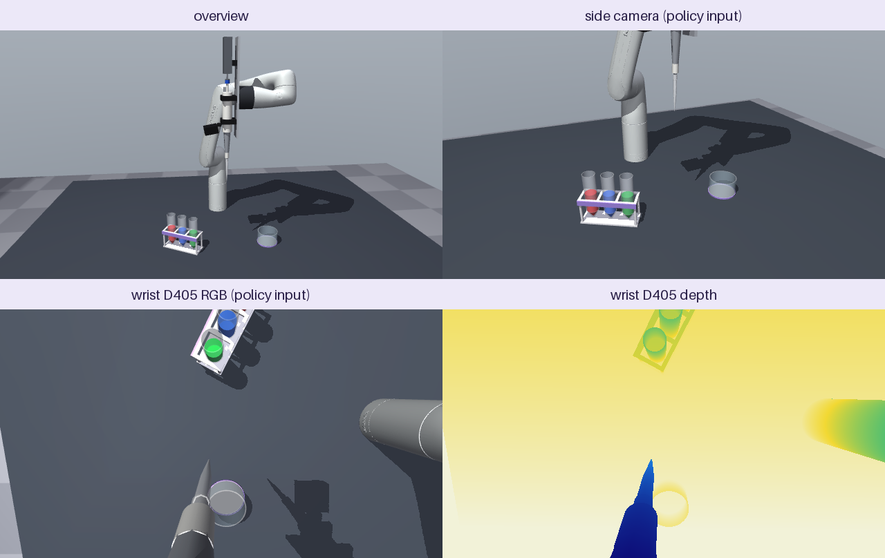

# Automated micropipette transfer with a Kinova Gen3 lite (MuJoCo)

Intro to Robotics final project. A Kinova Gen3 lite holds a standard manual micropipette in a clamp.
A linear actuator presses the pipette's plunger. The robot finds the tube holding the requested
liquid color, draws 1000 µL, carries it over, and dispenses it into a dish. This is a prototype for
automating repetitive pipetting such as media exchange in cell culture.

This repository holds the simulation. **Phase 1, the task scene, is done.** The controller and the
vision policy come next (see [Roadmap](#roadmap)).



## Quick start

```bash
conda activate mujoco
pip install -r requirements.txt     # mujoco 3.17, numpy, imageio(+ffmpeg), pillow

python scripts/check_scene.py       # all checks + images + video into outputs/ (~20 s, headless)
python scripts/view_scene.py --demo # watch red, blue, then green being moved in the MuJoCo viewer
python scripts/build_scene.py       # regenerate models/scene.xml after changing the layout
```

- `check_scene.py` renders offscreen with EGL, so it works over SSH.
- `view_scene.py` opens a window and needs a display. Over SSH, use `DISPLAY=:1` to show it on the lab
  machine's monitor.
- Options for `view_scene.py`: `--colors blue` picks the liquids, `--speed 2` plays faster, and running it
  without `--demo` just opens the scene for browsing.

## The task

Three 50 mL tubes in a rack hold **red, blue and green** liquid. The task names a color, and the
robot must move 1000 µL of that liquid into the dish, in three phases:

1. **Aspirate.** Go above the tube with the requested color and press the plunger to the first stop.
   Dip the tip 3 mm below the surface, then release the plunger slowly to draw the liquid.
2. **Transfer.** Lift out and carry the loaded tip along an arc to above the dish.
3. **Dispense.** Lower into the dish and press through to blow-out. Withdraw with the plunger held
   down, then release it and return to the ready pose.

The scripted controller (`pipette_sim/scripted.py`) reads which tube holds which color from the
simulator. The vision policy will only get the requested color. Training shuffles the tube colors
(see [Randomization](#randomization)), so the policy has to find the right tube in the camera images.

## The scene

The world frame is at the robot base. The bench top is at z = 0 and +x points forward. Units are
meters; liquid volumes are in µL.

| | |
|---|---|
| source | white rack with three 50 mL conical tubes (`tube_1..3`, left to right seen from the front), 30 mL each. Front-left, 0.32 m from the base. |
| destination | clear glass dish, 70 mm across × 45 mm tall (`dish`), starts empty. Front-right, 0.32 m from the base. The two stations are 0.30 m apart. |

### Robot: Kinova Gen3 lite

- **Kinematics and limits:** the 6-DoF kinematics, joint limits and torque limits come from Kinova's
  `ros_kortex` description (`gen3_lite_macro.xacro`). The meshes are Kinova's (BSD-3, see
  `models/assets/gen3_lite/LICENSE`).
- **Inertias:** link masses are Kinova's. Centers of mass and inertias were recomputed from the
  meshes, because the URDF's inertial origins lie outside several links.
- **Actuators:** joint position actuators with gravity compensation, standing in for the real
  arm's internal controllers. Collision shapes are capsules; the meshes are visual only.
- **Ready pose:** keyframe `ready` is an elbow-up posture with the pipette vertical and the tip end
  at (0.30, 0, 0.25).

### Pipette tool (like the reference picture)

A mounting plate on the flange holds the pipette vertically. The pipette is perpendicular to the
flange axis and 75 mm in front of the flange face. Positions below are along the pipette, measured
down from the flange height:

| part | detail |
|---|---|
| linear actuator | above the pipette (−170 to −70 mm); its rod presses the plunger button |
| plunger | 10 mm to the first stop (1000 µL), 13 mm to blow-out; at most 10 mm/s (~1 mL/s) |
| manual 1000 µL pipette | handle held by two clamps; nozzle end at 203 mm (site `nozzle`) |
| tip | 1000 µL, 76 mm long, permanently attached; its end at 267 mm (site `tip_end`) is the point the controller steers |
| wrist camera | Intel RealSense D405 on the lower clamp, on the far side of the pipette from the flange. It looks down the pipette, tilted 10° toward it, so the tip end sits just below the image center. |
| mass | 0.381 kg for adapter, plate, actuator, pipette, tip and camera (Gen3 lite payload: 0.5 kg) |

**Holding direction.** The arm holds the pipette from the side: the flange axis is horizontal and
tangential, so the wrist is on the pipette's right as seen from the front. With the flange pointing
away from the robot, the wrist folds back against the base and joints end up within 3° of their
limits. Holding from the side keeps every working pose at least 22° from the limits.

### Cameras

| camera | mount | spec | used by |
|---|---|---|---|
| `wrist` | D405 on the pipette clamp (see above) | 42×42×23 mm; FOV 87°×58° (`fovy=58` at 16:9); ideal range 7–50 cm | policy (RGB, optional depth) |
| `side` | Fixed at (0.85, −0.25, 0.45) at the front-right of the bench, looking at the workspace. It shows the rack and dish side by side; a camera directly to the side would line them up behind each other. | `fovy=45` | policy |
| `overview`, `top` | fixed | | documentation |



### Liquid model

MuJoCo does not simulate fluids. Instead, each tube, the dish and the tip track a volume and a color,
and the liquid is drawn as non-colliding shapes resized to match.

- **Aspirating:** releasing the plunger draws liquid only while the tip end is at least 0.5 mm below
  the surface. It can never draw more than the volume above the tip end; past that, it draws air.
- **Dispensing:** pressing the plunger pushes out liquid first. It lands in the container whose
  opening the tip end is inside, below the rim. Anywhere else it counts as a **spill**.
- **Plunger accounting:** liquid follows the actuator's commanded plunger position, not the simulated
  joint. Otherwise small joint vibrations during arm motion would "pump" liquid out.
- **Colors:** mixed liquids blend by volume.
- **Tube dead volume:** the tip cannot reach into the conical bottom of a tube (~3.8 mL).

`sim.events` counts what later rewards will need:
- volumes: aspirated, dispensed and spilled µL, and µL drawn from the wrong tube
- steps with the robot touching labware or the bench
- steps with the pipette or camera touching the arm (self-collision)
- steps with the tip touching anything

### Collision groups (`contype` / `conaffinity`)

| bit | group | collides with |
|---|---|---|
| 1 | ENV: bench, rack, tubes, dish | ARM, TOOL, TIP |
| 2 | ARM: robot links | ENV, TOOL, TIP |
| 4 | TOOL: plate, actuator, pipette, clamps, camera | ENV, ARM |
| 8 | TIP | ENV, ARM |

Tube and dish walls are rings of thin boxes. That leaves the tops open, so the tip can go inside.

## Python API

```python
from pipette_sim.sim import PipetteSim
from pipette_sim.motion import MotionPrimitives
from pipette_sim import scripted
from pipette_sim.randomization import randomize
import numpy as np

sim = PipetteSim()                          # loads models/scene.xml, 20 ms control step
sim.reset(target_color="blue")              # tubes default to red, blue, green (left to right)
result = scripted.run_task(MotionPrimitives(sim), on_phase=print)   # 1 Aspirate, 2 Transfer, 3 Dispense
# {'color': 'blue', 'source': 'tube_2', 'aspirated_ul': 1000.0, 'dispensed_ul': 1000.0, ...}

rgb = sim.render("wrist", 224, 126)                # uint8 HxWx3
depth = sim.render("wrist", 224, 126, depth=True)  # float32 meters
state = sim.state()        # privileged: tube colors, target, source tube, volumes, tip, TCP, plunger

info = randomize(sim, np.random.default_rng(0))    # shuffled colors, random target, moved labware, ...
```

**Lower level:**
- `sim.set_arm_targets(q)`: 6 joint angles for the position actuators
- `sim.set_plunger(m)`: plunger target in meters
- `sim.step()`: advance one control step
- `pipette_sim.ik.VerticalIK`: joint angles for a tip-end position with the pipette vertical

### Randomization

`randomize(sim, rng)` resets the scene and randomizes:
- which tube holds which color, and the target color
- tube volumes (20–45 mL)
- rack and dish poses (±2 cm, ±10°, never overlapping)
- material colors and lighting
- liquid colors (±0.04, so the three hues stay distinct)
- camera pose errors: ±2 mm / 1° on the wrist, ±2 cm / 2° on the side camera, plus ±1.5° FOV

## Verification (`scripts/check_scene.py`)

All 9 checks pass:

- **Payload and stability:** the tool is within payload, and the arm holds the ready pose with no
  contacts.
- **Reach:** all 13 working poses can be reached without collisions or self-collisions: above, at the
  surface and at the deepest point of each tube, and at the dish. Every one is at least 22° from all
  joint limits.
- **Each color:** the scripted task takes red, blue and green from the right tube. It moves exactly
  1000 µL into the dish with no spill and no contact of any kind, in about 42 s of simulated time
  per task.
- **Randomized scenes:** 20 scenes have no overlaps or contacts, and every tube and the dish can be
  reached. The scripted task succeeds in 6 of 6 scenes with shuffled colors and moved labware.

**Speed** (one process): 19,000 control steps/s for physics alone (380× real time). With the wrist and
side images rendered every step, about 1,700 steps/s.

Outputs:
- `outputs/check_report.md`: the report
- `outputs/task_demo.mp4`: all three colors, 2× speed, with phase labels
- images in `outputs/`

## Sim-to-real notes

**Hardware to build:**
- a flange plate with two pipette clamps (3D-printed or aluminum)
- a small position-controlled linear actuator that can press the plunger through to blow-out (stroke
  at least 13 mm)
- a D405 bracket

Measure your pipette's real plunger stroke and update `PLUNGER_FIRST_STOP` / `PLUNGER_BLOWOUT` in
`pipette_sim/specs.py`. Update the clamp and camera positions in `models/gen3_lite_pipette.xml` to
match what you build.

**Calibration:**
- wrist-camera intrinsics and hand-eye extrinsics
- the side-camera pose
- rack and dish positions in the robot base frame

**Control interface:** the Kortex API accepts joint-speed and Cartesian twist commands. The planned
policy action (tip velocity plus a plunger command) maps onto these. Kinova's ROS configuration
limits Cartesian speed to 0.3 m/s; the scripted motions use ≤ 0.15 m/s.

**Known simplifications:**
- no fluid dynamics: droplets, bubbles, meniscus, viscosity
- the plunger has no spring or force model
- depth is rendered ideal: the real D405 has noise, a 7 cm minimum range, and trouble with clear plastic
- transparent plastic and glass are approximated
- arm inertias are estimated

## Repository layout

```
models/
  gen3_lite_pipette.xml   robot + clamped pipette + actuator + D405 (hand-written)
  scene.xml               full scene (GENERATED by scripts/build_scene.py)
  assets/gen3_lite/       Kinova meshes + license
pipette_sim/              simulation package (see its __init__ docstring)
scripts/                  build_scene.py, check_scene.py, view_scene.py
docs/                     README images
outputs/                  check results (git-ignored)
```

## Roadmap

1. **Task scene.** Done.
2. **Controller and scripted expert.** A Cartesian tip-velocity controller and the three-phase state
   machine. This is the control-code deliverable and the demo, and it records demonstrations.
3. **Learning environment.** A Gymnasium environment that runs many simulations in parallel.
   - Observations: wrist and side images, robot and plunger state, and the target color.
   - Actions: tip velocity and a plunger command.
   - Rewards: given per phase (aspirated, transferred, dispensed), with penalties for spills,
     collisions and drawing from the wrong tube.
4. **Policy training.** Behavior cloning from the demonstrations, then PPO fine-tuning. PPO's critic
   can use the simulator's true state.
5. **Sim-to-real on the Gen3 lite.**
